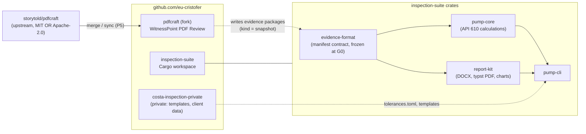
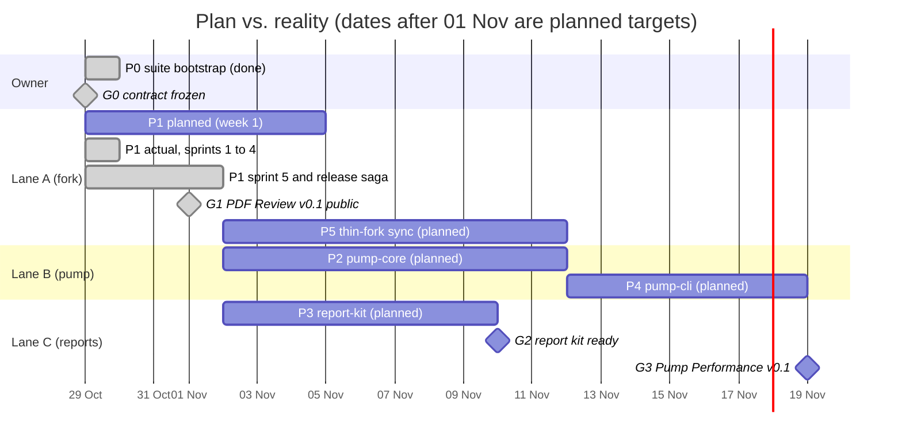
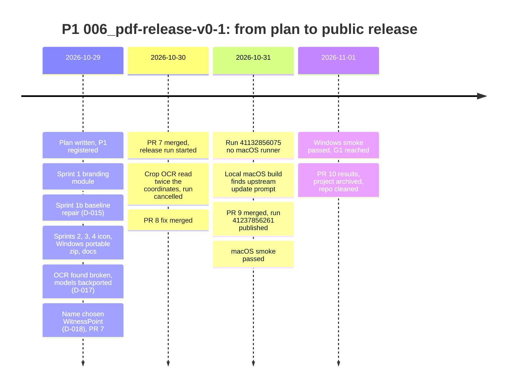
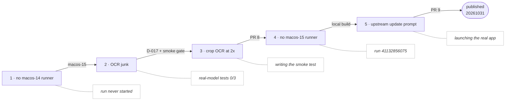
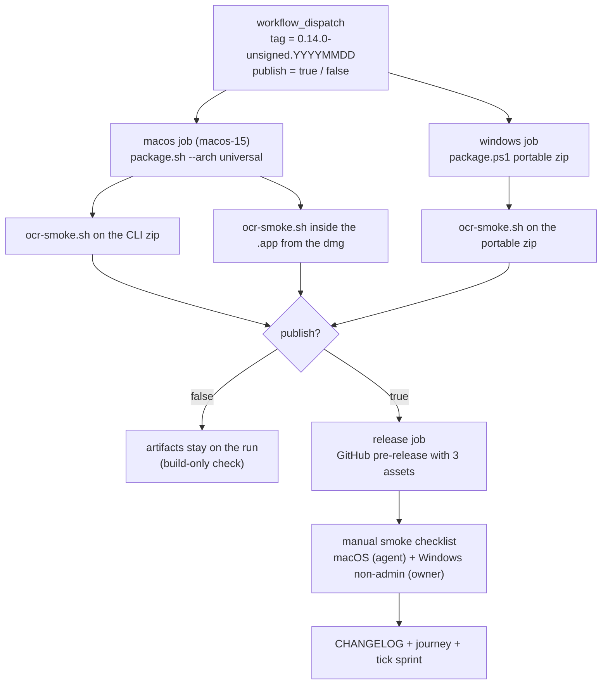

# 01 — The build record: how WitnessPoint PDF Review v0.1 was built

Status: record (frozen at G1) · Covers 2026-10-25 → 2026-11-01
Sources: [`../journey.md`](../journey.md), [`../decisions.md`](../decisions.md), [`../plan/official-plan.md`](../plan/official-plan.md), the fork's [`CHANGELOG.md`](https://github.com/eu-cristofer/pdfcraft/blob/main/CHANGELOG.md), the GitHub PRs and release runs linked below, and the transcript of the first planning session (2026-10-29).

This is what happened, in order, with the evidence for each step. For what each step *teaches*, read [02 — Didactic notes](02-didactic-notes.md). For how to keep the result alive, read [03 — Maintain and upgrade](03-maintain-and-upgrade.md).

## The shape of the work

Source: [`diagrams/suite-architecture.mmd`](diagrams/suite-architecture.mmd)

- **Upstream** `storytold/pdfcraft` is a fast-moving open-source PDF editor in Rust (MIT OR Apache-2.0).
- **The fork** `eu-cristofer/pdfcraft` adds a crop-review workspace, OCR on crops and an evidence-package export. It ships as **WitnessPoint PDF Review**.
- **`inspection-suite`** is the company's own Cargo workspace. It holds the shared evidence format and, later, the pump-performance tool.
- **`costa-inspection-private`** holds what must never be public: client data, templates and the licensed API 610 values.

## Phase 0 — Fork feature work (2026-10-25 → 10-28, before the plan)

The fork was created from upstream commit `83ba2868`. Five sprint projects were delivered with `/sprint-loop`:

| Project | What it delivered |
|---|---|
| `001_snapshot-export-contract` | manifest, LaTeX, raster evidence |
| `002_selected-rec` | rectangle comments → export items |
| `003_export-flow` | headless and desktop rectangle export, OCR |
| `004_crop-review-workspace` | Crops panel, metadata, project-folder persistence |
| `005_export-contract-hardening` | manifest v1.1, `report.marker.json`, optional `report.docx`, embedded persistence |

They landed as fork PRs #1–#6. The end state was branch `feat/crop-panel-unification` @ `17649c1b`: 60 commits and about 10k lines. Most of it was in new files, but about 2,800 lines sat inside upstream's `crates/engine/src/export.rs`.

## Phase 1 — The first session: from "check my fork" to an official plan (2026-10-29, 02:53 → 06:12)

The owner opened with: *"analyze my work and solution and advise me like a senior software developer with an eye on the future. What is the best way to handle my project?"* The session then went through five turns:

1. **The fork review.**
   - **Facts:** upstream was 373 commits ahead, 558 files had changed, and a dry-run merge conflicted in 16 files.
   - **Diagnosis:** the code was fine; the problem was *where it sat*. The fork behaved like a branch meant to merge back, but it is really a downstream product (D-001).
2. **Licence and open source.**
   - **Licence:** MIT OR Apache-2.0 allows free in-house commercial use and publication (D-002).
   - **Trademarks:** the ArtCraft marks are a separate matter. Their brand licence forbids them in forks, so they had to go before any release (D-003).
   - **Name:** the product needed its own name.
3. **"It will be part of my inspection suite, with a pump performance tool."**
   - **Layout:** 3 repos (D-004).
   - **Shared contract:** the evidence format as the suite-wide contract.
   - **Pump calculations:** pure functions, kept apart from any I/O.
4. **"API 610. Can we design it to have a fast solution from what is already ready?"** The advice flipped to *ship first, refactor later* (D-005):
   - **Release:** release the PDF tool as it is.
   - **Pump tool:** build a narrow CLI MVP.
   - **Limits:** keep the API 610 limits as data from the licensed copy (D-006).
   - **Shared crates:** extract them only when a second tool needs them (the rule of two).
5. **"How many independent projects… parallel and sequential?"** The work was split into projects P0–P7, 3 lanes and gates G0–G3 (D-007…D-010). It was written up as the official plan, the journey and the decision log. Typst was chosen for PDF reports.

Later the same day:
- **Where the repos live:** all repos stay on the personal account `eu-cristofer` (D-012).
- **A short detour:** a standalone-repo restart (D-013) was tried and reversed within hours. The owner's instruction was *"follow strictly our design"* (D-014).

## Phase 2 — Plan and gates

Source: [`diagrams/plan-lanes.mmd`](diagrams/plan-lanes.mmd)

| Gate | Target | Reached |
|---|---|---|
| G0 — contract frozen | Day 1 | 2026-10-29 (P0, inspection-suite PR #1) |
| G1 — PDF Review v0.1 public | Week 1 | **2026-11-01** |
| G2 — report kit ready | Week 2 | not started |
| G3 — Pump Performance v0.1 | Week 3–4 | not started |

## Phase 3 — P1 `006_pdf-release-v0-1`, sprint by sprint

Source: [`diagrams/p1-timeline.mmd`](diagrams/p1-timeline.mmd)

| Sprint | Commit(s) | What it did |
|---|---|---|
| 1 Branding module | `494c4b95` | `branding.rs`; the ArtCraft logo replaced by the suite's own mark; "Based on PdfCraft" in About; window title from `APP_NAME` |
| 1b Baseline repair (D-015) | `448d5da7` | Fixed 20 failing tests that predated P1, including a real bug (a quick corner-handle drag missed the handle). ui-egui: 1775 passed, 0 failed |
| 2 Icon, ids, packaging metadata | `d92caf7b` | ArtCraft Discord and website links replaced by the fork's Help and GitHub; placeholder icon; `docs/brand/` deleted; `NOTICE` says "modified version by Costa Inspection" |
| 3 Windows portable zip | `edaeb243`, `34fb8fae` | `unsigned-release.yml` builds the portable zip with the OCR models |
| 4 Fork docs layout | `c4ec8e6b` | Fork docs moved to `docs/fork/`; upstream's `AGENTS.md`, `CLAUDE.md` and `ROADMAP.md` restored byte-identical; the fork's own README (D-016) |
| 5 Release | `84be5e3b` … PR #10 | Final names (D-018), the release, the smoke tests (below) |

## Phase 4 — The release saga (sprint 5)

Four release attempts were needed to publish v0.1. A different check caught each problem:

Source: [`diagrams/release-saga.mmd`](diagrams/release-saga.mmd)

| # | Problem | How it was caught | Fix | Evidence |
|---|---|---|---|---|
| 1 | The macOS job never got a `macos-14` runner | Run 40854286030 never started its macOS job | Move to `macos-15`; a new `publish` input, off by default, so test runs never publish | D-017 |
| 2 | **OCR returned junk (`1`, `T`) in every build.** Fork commit `17649c1b` had swapped in mismatched model checkpoints during an upstream URL outage | The real-model engine tests: 0/3 | Backport upstream `da8cea2b` (ONNX models plus lookup); new `packaging/ocr-smoke.sh` gate on every package | D-017; runs 40860103527 and 40862374532 green |
| — | Owner's naming input (U1) still open | Sprint 5 gate | Owner: *"It is up to you"* → **WitnessPoint** | D-018, PR [#7](https://github.com/eu-cristofer/pdfcraft/pull/7) |
| 3 | **Crop OCR read the area at twice its coordinates** (the tile was scaled twice, fork commit `40fa1c31`, 10-26). Hidden while OCR never worked | Writing the smoke test's 3-crop check | Scale once; a new engine test that fails without the fix. Run 40992395586 **cancelled before publishing** | PR [#8](https://github.com/eu-cristofer/pdfcraft/pull/8) |
| 4 | The macOS job did not get a `macos-15` runner either | Run 41132856075 (Windows passed) | Owner: *"why don't you try to run locally first?"* → a local universal build | journey 10-31 |
| 5 | **The app offered "PdfCraft v0.14.0 → 0.15.0, UPDATE AND RESTART"**. Accepting would install upstream's ArtCraft-branded app over ours | Launching the locally built app; no test could see it | No update check at start; Help ▸ Check for updates opens the fork's releases page; 2 guard tests | PR [#9](https://github.com/eu-cristofer/pdfcraft/pull/9) |

Run **41237856261** then built, OCR-checked and published the pre-release [`0.14.0-unsigned.20261031`](https://github.com/eu-cristofer/pdfcraft/releases/tag/0.14.0-unsigned.20261031): a universal macOS dmg, a macOS CLI zip and a Windows x64 portable zip.

Source: [`diagrams/release-pipeline.mmd`](diagrams/release-pipeline.mmd)

## Phase 5 — Smoke tests, G1 and close-out (2026-10-31 → 11-01)

**macOS (by the agent, on the downloaded release files).** The SHA-256 of each file matched GitHub's digest.
- `ocr-smoke.sh` passed on the CLI zip and inside the `.app`.
- The code signature check passed; the bundle id is `com.costainspection.witnesspoint-pdf`; the app is universal (x86_64 + arm64); there was no update prompt.
- In the app, driven through its `--control` interface on a synthetic 3-line scan:
  - drew 3 crops and gave each a caption and a note;
  - saved, closed and reopened: everything was kept;
  - exported the package with `report.docx`: `item_1..item_3` in order, 3 PNGs, and each `ocr_text` exactly its line;
  - About shows "WitnessPoint PDF Review" and "Based on PdfCraft…".

**Windows (by the owner, on a non-admin account, from the portable zip):** passed in full.

**Deviation recorded:** the UI has no "save project folder" command, so the save and reopen step used File ▸ Save, which stores the crops inside the PDF.

**Close-out:**
- PR [#10](https://github.com/eu-cristofer/pdfcraft/pull/10) added the results to the CHANGELOG, ticked sprint 5 and archived the project to `docs/archive/2026-11-01_006_pdf-release-v0-1`.
- The merged branches were deleted.
- G1 was marked in the journey.

## Reference: every PR, run and decision of P1

| Kind | ID | Date | What |
|---|---|---|---|
| PR | [#7](https://github.com/eu-cristofer/pdfcraft/pull/7) | merged 10-30 | WitnessPoint PDF Review v0.1 (sprints 1–5 code) |
| PR | [#8](https://github.com/eu-cristofer/pdfcraft/pull/8) | merged 10-30 | Crop OCR reads the selected portion |
| PR | [#9](https://github.com/eu-cristofer/pdfcraft/pull/9) | merged 10-31 | No upstream update prompt |
| PR | [#10](https://github.com/eu-cristofer/pdfcraft/pull/10) | merged 11-01 | Results, tracker ticked, project archived |
| Run | 40854286030 | 10-29 | failed: no `macos-14` runner |
| Run | 40860103527, 40862374532 | 10-29 | green, build only (OCR gate passing) |
| Run | 40992395586 | 10-30 | cancelled: crop OCR bug found |
| Run | 41132856075 | 10-30 | failed: no `macos-15` runner (Windows green) |
| Run | **41237856261** | 10-31 | **published** `0.14.0-unsigned.20261031` |
| Decisions | D-001…D-010 | 10-28/29 | first session: product stance, licence, layout, ship first, API 610 as data, lanes, typst |
| Decisions | D-012, D-014…D-018 | 10-29 | GitHub home, design restored, baseline repair, own README, OCR backport, the WitnessPoint name |
