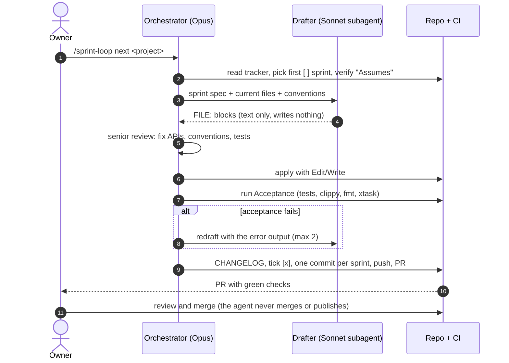

# 02 — Didactic notes: the ideas behind the build

Status: training notes · Audience: engineers and inspectors who will maintain or extend the WitnessPoint suite · Prerequisite: none. Each concept stands on its own.

Each section has three parts:
- **What it is:** the general idea.
- **Here:** how it showed up in this project, with evidence.
- **Takeaway:** what to do next time.

Exercises are at the end. The full chronology is in [01 — Build record](01-build-record.md).

---

## 1. Downstream product vs. upstream contribution

**What it is.** A fork can be either of two things:
- a *branch on its way back* to the original project (an upstream contribution);
- a *product of its own* built on top of it (downstream).

The two need opposite habits. A contribution edits the original files freely, because they will merge back. A product should touch upstream files as little as possible, because every edited line conflicts again at every sync.

**Here.** The fork's crop-review work was good code in the wrong place: about 2,800 lines inside upstream's `crates/engine/src/export.rs`. A dry-run merge conflicted in 16 files. D-001 recorded that the fork is a downstream product. P5 will move the fork's code into fork-owned files ("thin fork").

**Takeaway.** Decide *what the fork is* on day one. If it's a product, put your code in new files and keep the hooks into upstream small.

## 2. Licence vs. trademark

**What it is.** An open-source licence covers the *code*; it does not cover the *brand*. Apache-2.0 §6 explicitly grants no trademark rights. You may use, change and redistribute the code. You may not suggest that the original authors make or endorse your product.

**Here.** MIT OR Apache-2.0 allowed free commercial use and publication (D-002). The ArtCraft brand licence, however, forbids its marks in forks (D-003), so P1 removed:
- the logo in `widgets.rs`;
- `docs/brand/`;
- the Discord and website links;
- the README screenshot.

The product got its own name (D-018). Only the plain-text attribution "Based on PdfCraft by the ArtCraft Team" remains. That is normal and allowed.

**Takeaway.** Before any release:
- keep `LICENSE-*`, `NOTICE` and `ATTRIBUTION`;
- say that you modified the code;
- remove the other project's marks;
- choose your own name, after a quick search for collisions.

## 3. Ship first, refactor later, and the rule of two

**What it is.** Release what already works, learn from real use, and only then restructure. Extract a shared library when a *second* consumer actually needs it (the rule of two), not before. An abstraction built early guesses at needs and slows you down.

**Here.** The first advice was "refactor into a thin fork, then release". On the owner's question *"Can we have a fast solution from what is already ready?"* it flipped to release v0.1 from the existing branch (D-005). The thin-fork refactor moved to P5, after G1. The shared report code stays duplicated until the pump tool needs it.

**Takeaway.** Order the work by value. A working release in week 1 beats a clean architecture in week 3.

## 4. A frozen interface contract unblocks parallel work

**What it is.** When several people or agents build pieces that must fit together, agree on the *interfaces* first and freeze them. After that, each lane works on its own side without editing the same files.

**Here.** Gate G0 froze three contracts (D-008):
- `evidence-format` v1: the manifest schema, readable from the fork's v1.1 packages;
- the `pump_core` public types;
- the `report_kit` public types.

That is what lets lanes B (pump) and C (reports) run at the same time. Changing a contract after G0 needs a new decision entry.

**Takeaway.** Parallel work is cheap only after the contract is frozen. Spend day 1 on it.

## 5. Limits are data, not code

**What it is.** Regulated limits change between editions of a standard, and the standard's text is copyrighted. Hard-coding them from memory means a wrong value can silently pass or fail a real acceptance test.

**Here.** API 610 tolerances come only from `tolerances.toml`, which the owner fills in from the licensed copy (D-006, input U2). Every report records which edition it used. The public example file refuses to run by default, and golden tests reproduce past signed-off jobs (U3).

**Takeaway.** If a number has a source document, it belongs in a data file that names the source, never in code.

## 6. The sprint-loop method: drafter and reviewer

Source: [`diagrams/sprint-loop.mmd`](diagrams/sprint-loop.mmd)

**What it is.** The work is split into roles:
- **Orchestrator:** picks the sprint, builds the context and judges the result.
- **Drafter (a cheaper model):** writes most of the code.
- **The owner:** keeps the irreversible actions, merging and publishing.

Each sprint is *self-contained*: Goal, Files, Reuse, Tests, Acceptance commands, Definition of done and Assumes. A run never needs the planning conversation.

**Here.**
- **Drafting and review:** the Sonnet drafter wrote the bulk of sprint 5. The orchestrator fixed what it got wrong: a rewritten README, wrong sprint numbers in the CHANGELOG, and the missed window title.
- **Merging and publishing:** the permission system refused the agent's `gh pr merge` and `publish=true`. The owner merged and dispatched every time.
- **Ticking and archiving:** sprints are ticked only when their Acceptance commands pass, and finished projects are archived (`docs/archive/2026-11-01_006_…`).

**Takeaway.** Separate drafting from judging, and keep publish rights with a human. A sprint spec that "needs the conversation" is not finished.

## 7. Test the package, not the dev build

**What it is.** A dev build finds its resources in the source tree. A shipped package must find them next to itself. Tests that run from the repo can't tell you whether the *package* works.

**Here.** `packaging/ocr-smoke.sh` runs on the *packaged* CLI with `PDFCRAFT_MODELS` unset, so it must find the bundled models:
1. it turns a 3-line text into a PDF, then into a picture, then back into a scanned PDF with no text layer;
2. it OCRs the page and checks the words;
3. it exports a 3-crop evidence package and checks that each crop's `ocr_text` is its own line.

It runs on the Windows zip, the macOS CLI zip and inside the `.app`, and the release can't publish unless it passes (D-017).

**Takeaway.** Every release artefact gets an automated check that runs the artefact itself.

## 8. Tests that pass because the feature is broken

**What it is.** A test that only checks "no error" or "empty is fine" can stay green while the feature behind it is dead. When the feature comes back to life, the wrong assertion shows.

**Here.** OCR returned junk for days because of mismatched models. Two export tests passed *only because* OCR could not run. Once OCR worked, they exposed that the crop OCR read the area at **twice its coordinates** (PR #8). That bug had been in the code since 10-26.

**Takeaway.** For every important feature, keep one test that proves it *produces the right output*, and make sure it fails when the feature is switched off (CLAUDE.md: "prove a test fails before the fix").

## 9. Launch the real app

**What it is.** Automated tests check what someone thought to check. A product can still misbehave in ways nobody modelled: a dialog, a network call, a prompt.

**Here.** All CI was green. Launching the locally built app showed **"PdfCraft v0.14.0 → 0.15.0, UPDATE AND RESTART"**: upstream's updater, reading upstream's feed. One click would have replaced WitnessPoint with upstream's branded app. PR #9 removed it and added guard tests. The owner's suggestion to build locally ("why don't you try to run locally first?") is what exposed it.

**Takeaway.** The release checklist always includes a human (or agent) launching the shipped binary and looking at it.

## 10. Keep-in-sync lists

**What it is.** The same identity value often has to appear in several places: the app id, the bundle id, the installer upgrade code, display names. One missed copy causes bugs that are hard to see.

**Here.**
- `crates/ui-egui/src/branding.rs` is the source of truth. Each copy in packaging is marked "keep in sync with branding.rs".
- CI caught one miss: the MSI's context-menu release detection still used the old `UpgradeCode` (commit `44b99d9f`).
- A test held a captured macOS LaunchServices binding with the old bundle path, so it had to be re-encoded.

**Takeaway.** Name one source of truth, mark every copy, and add a test that compares them.

## 11. Journey log and decision log

**What it is.** Two living documents:
- **`journey.md`:** where we are, what happened, what's next. A status board, gates, user inputs, and a dated log with the newest entry first.
- **`decisions.md`:** one row per decision that changes scope, architecture or a contract. Rows are never deleted; a reversal is a new row that says "supersedes".

**Here.** Every session ended with a journey entry. D-013 (start again in a standalone repo) was superseded by D-014 a few hours later, and both remain readable. This training material was written almost entirely from those two files.

**Takeaway.** If it isn't in the journey or the decision log, the next person (or the next AI session) won't know it happened.

---

## Exercises

1. **Diagnose a fork.** Run `git diff --stat $(git merge-base HEAD upstream/main)` in the fork. Count the upstream-owned files the fork changes. Which three would you move first in P5, and why?
2. **Licence check.** A client asks for a build with their logo next to "Based on PdfCraft". Which files must change? Is anything forbidden?
3. **Break the smoke test.** Remove `models/` from a portable zip and run `packaging/ocr-smoke.sh` on it. Which check fails first? Then put the double-scaling bug back (see PR #8) and confirm the 3-crop check catches it.
4. **Find a false-pass test.** Pick a test in `crates/automation/tests/it/` that asserts on OCR. Does it still pass with OCR switched off? If it does, how would you fix it?
5. **Contract change.** P7 needs a new `kind = "digitized_curve"`. List the documents and lanes that must be told, according to D-008.
6. **Discussion.** The release needed four attempts. Which of the five problems could the original plan have caught on day 1, and at what cost?
