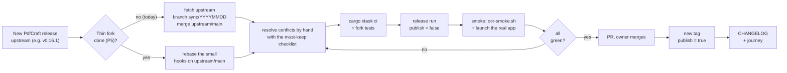

# 03 — Maintain and upgrade WitnessPoint PDF Review

Status: handbook · Applies to fork `eu-cristofer/pdfcraft` from `0.14.0-unsigned.20261031` on.

This handbook says *what* to do and *what must never be lost*. For the exact git and `gh` commands it links to the fork's own runbooks. Those are the source of truth, and they live next to the code they describe:
- [`docs/fork/techind/update-fork-and-release.md`](https://github.com/eu-cristofer/pdfcraft/blob/main/docs/fork/techind/update-fork-and-release.md): sync with upstream, then cut a release.
- [`docs/fork/fork-sync-sop.md`](https://github.com/eu-cristofer/pdfcraft/blob/main/docs/fork/fork-sync-sop.md): the general fork-sync SOP.

---

## 1. Repo map: what lives where

| Piece | Where | Notes |
|---|---|---|
| Names and ids | `crates/ui-egui/src/branding.rs` | **Source of truth.** `SUITE_NAME`, `APP_NAME`, `APP_ID = com.costainspection.witnesspoint-pdf` |
| Copies of the ids | `apps/pdfcraft/src/main.rs`, `crates/ui-egui/src/macos_association.rs`, `packaging/macos/Info.plist.in`, `packaging/windows/pdfcraft.wxs` (own `UpgradeCode`), `apps/*/build.rs` | Each one is marked "keep in sync with branding.rs" |
| Updater | `crates/ui-egui/src/updates.rs` | Opens the fork's releases page; **never** asks upstream's feed (PR #9) |
| OCR models | `ATTRIBUTION.toml` (URLs and SHA-256), `crates/ocr/src/lib.rs` (lookup), fetched by `cargo xtask models` | ONNX pair; the lookup prefers ONNX and falls back to `.rten` (D-017) |
| Release workflow | `.github/workflows/unsigned-release.yml` | Inputs: `tag`, `publish` (default false). Jobs: `macos` (`macos-15`), `windows`, `release` |
| Release gate | `packaging/ocr-smoke.sh` | Runs on every package; a failure blocks publishing |
| Quality gates | `cargo xtask ci` (`.github/workflows/ci.yml`) | fmt, clippy, tests, i18n, layers, wasm, assets, deny, parity |
| Fork docs | `docs/fork/` (index in `docs/fork/README.md`); sprint projects in `docs/changes/` and `docs/archive/` | Upstream's `AGENTS.md`, `CLAUDE.md` and `ROADMAP.md` stay byte-identical to upstream |
| Fork README | `README.md` with `merge=ours` in `.gitattributes` (D-016) | Needs `git config merge.ours.driver true` **once per clone** |

> ⚠️ **Two upstream workflows to know about.**
> - `release.yml` runs on a push to a branch named `release`. Never create a branch with that name in the fork.
> - `ci.yml` has a check called **"Git dependencies come from storytold"**. It fails if any git dependency is not from `github.com/storytold/`. The P5 plan wants `evidence-format` as a git dependency on `eu-cristofer/inspection-suite`, which this check would reject. P5 has to decide how to handle it: a crates.io release, a vendored copy, or a fork-specific exception, recorded as a new decision.

---

## 2. Routine tasks

### Cut a release from the current `main`
1. Make sure `main` is green (CI on the last merge).
2. Tag: `<upstream-version>-unsigned.<YYYYMMDD>`. Read the upstream version from `Cargo.toml` `[workspace.package]`, as the runbook shows.
3. **Build-only run first:** `publish=false`. Check that all three OCR smoke steps passed.
4. **Owner** dispatches with `publish=true` (the agent does not publish).
5. Check the release has **3 assets**:
   - `…-macos-universal.dmg`;
   - `pdfcraft-cli-…-macos-universal.zip`;
   - `…-windows-x64-portable.zip`.

   (The runbook still says "four assets". The MSI is built but not published in v0.1.)

### Smoke-test a release (the sprint-5 checklist)
On the **downloaded** files, check that each file's SHA-256 matches the digest GitHub shows. Then:
1. `packaging/ocr-smoke.sh <packaged pdfcraft-cli>` for the CLI zip and the `.app`. On Windows, use Git Bash with `pdfcraft-cli.exe`.
2. Launch the app. Check that the title is "WitnessPoint PDF Review", that About shows "Based on PdfCraft…", and that **no update prompt** appears.
3. Open a **synthetic** PDF. Draw 3 crops and edit their captions and notes. Save, close and reopen; the crops must still be there.
4. Export Crop Review Package with `report.docx`. Check `manifest.json` lists `item_1..item_3` in order, `evidence/` has 3 PNGs, and each `ocr_text` is correct.
5. Windows: run steps 2–4 on a **non-admin** account, from the portable zip.

### Record it
- Fork `CHANGELOG.md`: one bullet per user-visible change, plus a "Released" bullet with the smoke results.
- `inspection-suite/docs/journey.md`: a dated entry, plus the status board and gates.
- A new decision? Add a row to `decisions.md`. Never edit an old row; supersede it.
- Finished sprint project: `/sprint-loop archive <slug>`.

---

## 3. When PdfCraft releases a new version

Upstream moves very fast: 373 commits in the 3 days before the plan, and **742 commits** past our base `83ba2868` by 2026-11-01. Its latest tag is **v0.16.1** (2026-10-30), while v0.1 is built on 0.14.0. A sync is a real merge, not a fast-forward.



<sub>Source: [`diagrams/upgrade-flow.mmd`](diagrams/upgrade-flow.mmd)</sub>

### 3.1 Before you start
- **Decide why you're syncing.** You might need a fix (security, a file that won't open), want a feature, or be doing routine catch-up. If you only need one fix, a **narrow backport** is cheaper: that's what D-017 did for the OCR models.
- One-time setup per clone:
  - `git remote add upstream https://github.com/storytold/pdfcraft.git`. (The local `~/GitHub/pdfcraft.back` has **no `upstream` remote yet**; `~/GitHub/pdfcraft` is a plain upstream clone.)
  - `git config merge.ours.driver true`.
- Read upstream's `CHANGELOG.md` between our version and theirs. Note anything about **updates, OCR models, packaging ids, the MSI, `AGENTS.md`**: these are where the fork differs.

### 3.2 Today's path: merge (until P5 is done)
Follow [`update-fork-and-release.md`](https://github.com/eu-cristofer/pdfcraft/blob/main/docs/fork/techind/update-fork-and-release.md) §2–§5, on a branch `sync/YYYYMMDD`, landing through a PR. Expect conflicts in the files the 2026-10-28 dry run listed: `engine/src/export.rs`, `engine/src/lib.rs` and `ui-egui/src/{lib,canvas,control,panels,editing,commands,chrome}.rs`, among others.

**Read every conflicting hunk.** Never resolve a conflict by blindly taking one side.

### 3.3 The must-keep checklist (check this after every merge)

| # | Must stay true | How to check |
|---|---|---|
| 1 | No ArtCraft marks: no logo, no `docs/brand/`, no Discord or community links, no "part of ArtCraft" | `! grep -rni "getartcraft\|docs/brand" crates apps packaging`; look at the About box |
| 2 | Names and ids from `branding.rs`, in every copy | grep for `com.costainspection.witnesspoint-pdf`; `! grep -rn "<Suite>" crates apps packaging` |
| 3 | The MSI's own `UpgradeCode` `5045380A-…`, on the Package element **and** on `<Upgrade Id>` | `packaging/windows/test-msi.ps1` (Windows ARM64 CI job) |
| 4 | **The updater never asks upstream's feed** | tests `no_update_check_at_start` (`apps/pdfcraft/src/main.rs`) and `check_for_updates_opens_this_forks_releases_page_without_asking_upstream` (`crates/ui-egui/tests/it/updates.rs`); launch the app |
| 5 | The OCR models: an ONNX pair, the SHA-256 in `ATTRIBUTION.toml`, models in every package | `cargo xtask assets`; `ocr-smoke.sh` |
| 6 | Crop OCR reads the selected area (scaled once) | engine test `snapshot_export_ocr_reads_the_selected_portion_of_a_scan` |
| 7 | The crop-review hooks (Crops panel, export dialog, automation tools) still wired in | ui-egui and automation tests; smoke step 3–4 |
| 8 | Parity evidence names tests that exist | `cargo xtask ci` (the parity step runs last) |
| 9 | The fork's README, `NOTICE` ("modified version by Costa Inspection") and `docs/fork/` | `git diff upstream/main -- README.md NOTICE` |
| 10 | Upstream's `AGENTS.md`, `CLAUDE.md` and `ROADMAP.md` byte-identical to upstream | `git diff upstream/main -- AGENTS.md CLAUDE.md ROADMAP.md` is empty |

Then:
1. Run `cargo xtask ci`.
2. Do a build-only release run.
3. Run the smoke checklist (§2).
4. Open a PR; the owner merges.
5. Cut a release with the **new upstream version** in the tag, e.g. `0.16.1-unsigned.YYYYMMDD`.
6. Record it in the CHANGELOG and the journey.

### 3.4 The planned path: thin fork (P5)
P5 makes every later sync cheap. It is unblocked now that G1 is done:
1. Tag `backup/crop-review-v0.1`.
2. Branch from `upstream/main`.
3. Re-add the crop review and snapshot export as **new files**, with small hooks into upstream.
4. Move the ~2,800 fork lines of `engine/src/export.rs` into a fork-owned crate. Keep the v1.1 manifest byte-compatible.
5. Add a nightly CI job that builds the fork on the latest `upstream/main`.
6. Set a weekly sync routine.

**Done when:** the fork changes about 10 upstream files or fewer, with small hooks, and the nightly upstream build is green. After P5, an upgrade is mostly "rebase the hooks, run the checklist".

---

## 4. Quick reference

```text
New upstream version?
  ├─ Need one fix only? → narrow backport + decision entry (like D-017)
  └─ Full sync → branch sync/YYYYMMDD → merge upstream/main → must-keep checklist (10 rows)
        → cargo xtask ci → release run publish=false → smoke (CLI zip, .app, Windows zip, real app)
        → PR (owner merges) → tag <upstream-version>-unsigned.<date> → owner publishes
        → CHANGELOG "Released" + journey entry
Never: a branch named `release` · auto-resolve a conflict · re-run an old release run (it rebuilds old code) · publish before the smoke test
```
