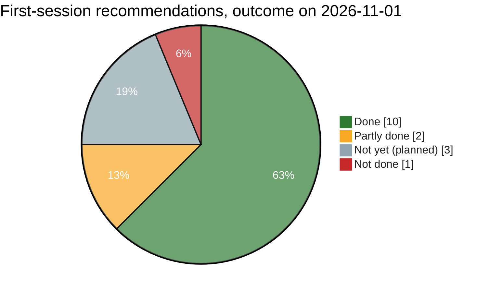

# 04 — Retrospective: was the first session's idea carried out well?

Status: assessment as of 2026-11-01 (G1) · Method: every recommendation from the first planning session (2026-10-29, transcript `eca49010…`) is checked against the repos, the decision log and the published release.

## The idea, in the owner's words and the advice that followed

| Owner asked | Core advice |
|---|---|
| "Analyze my work… advise me like a senior software developer with an eye on the future" | The code is good; it sits in the wrong place. Treat the fork as a downstream product, keep the patch to upstream thin, and ask upstream for an extension point |
| "Can I adopt this solution, publish it as open source and use it at my company for free?" | Yes, under MIT OR Apache-2.0. Keep the notices, remove the ArtCraft marks, use your own name, never commit client data, and treat the output as having no warranty |
| "It will be part of my inspection suite tools. It will have a pump performance tool" | 3 repos; the evidence format as the suite contract; pure pump calculations |
| "API 610. Can we design it to have a fast solution of what is already ready?" | Flip the order: release the PDF tool as it is (rebrand plus a Windows build with OCR); pump CLI MVP; limits as data; the rule of two |
| "Plan it… how many independent projects… parallel and sequential?" | P0–P7, 3 lanes, gates G0–G3, official plan, journey, decisions |

## Scorecard

Source: [`diagrams/retrospective.mmd`](diagrams/retrospective.mmd)

| # | Recommendation | Outcome | Evidence |
|---|---|---|---|
| 1 | Decide what the fork is: a downstream product | ✅ done | D-001 |
| 2 | Ship v0.1 from the working branch first; refactor later | ✅ done | D-005; G1 on 2026-11-01, inside the week-1 target |
| 3 | Remove the ArtCraft marks before any release | ✅ done | P1 sprints 1–2 and 4; the About box shows only the plain-text "Based on PdfCraft" |
| 4 | Give the product its own name | 🟨 partly | Named **WitnessPoint PDF Review** (D-018), but upstream's name still shows in places (next table) |
| 5 | Keep the licence notices and say you modified the code | ✅ done | `LICENSE-*`, `ATTRIBUTION.*` and `NOTICE` ("Modifications Copyright (c) 2026 Costa Inspection") ship in every package |
| 6 | A Windows build with the OCR models | ✅ exceeded | The portable zip has the models, and *every* package must pass an OCR smoke test before publishing (D-017) |
| 7 | Synthetic data only, no client data | ✅ done | All tests and smoke runs use generated PDFs; client material goes in `costa-inspection-private` |
| 8 | 3-repo layout | ✅ done | `eu-cristofer/pdfcraft`, `inspection-suite`, `costa-inspection-private` (private) all exist (D-004, D-012) |
| 9 | The evidence format as the suite-wide contract | ✅ done | `evidence-format` v1 reads the fork's v1.1 manifests unchanged; frozen at G0 (D-008) |
| 10 | API 610 limits as data from the licensed copy | 🟨 designed | D-006 and the P2 spec; the values (U2) and golden jobs (U3) are still owed |
| 11 | Golden tests from past signed-off jobs | ⬜ not yet | Planned for P2 sprint 6 (U3) |
| 12 | Thin fork: move the 2,800 lines out of `export.rs` | ⬜ not yet | P5, unblocked by G1 |
| 13 | Pump performance CLI MVP | ⬜ not yet | P2 → P4; G2 and G3 open |
| 14 | Open an upstream issue asking for an area/crop export extension point | ❌ not done | No issue from `eu-cristofer` on `storytold/pdfcraft` |
| 15 | Parallel lanes with sprint-loop; the owner as reviewer | ✅ done | D-009; the owner merged PRs #7–#10 and dispatched every release |
| 16 | Document it: plan, journey, decision log | ✅ done | 18 decisions and a dated journey; this training material is built from them |

**Tally:** 10 done, 2 partly, 3 not yet (planned in later projects), 1 not done.

## Found while writing this assessment

Checking every claim against the files turned up one problem that went out with v0.1:

- **The shipped `NOTICE` still starts with `<Suite> PDF Review`.** The placeholder from before the name was chosen was never replaced in `NOTICE`, and `NOTICE` ships in every package. The legal content is right (the modified-version line, Costa Inspection, the trademark disclaimer); only the product name is the placeholder. Other places still have it:
  - `ATTRIBUTION.toml` and `ATTRIBUTION.md` (the suite-mark title);
  - `assets/app-icon/README.md` and `LICENSE.txt`;
  - `docs/fork/README.md`.
- **Why it slipped:** sprint 5's acceptance check, `! grep -rn "<Suite>" crates apps packaging`, only searched the code folders. Top-level legal files and assets were outside it. That's a small example of lesson 7 (check what you ship, not only what you build).
- **Fix:** a v0.1.1 patch that replaces the placeholder and widens the grep to the whole repo (except `docs/archive/` and `CHANGELOG.md`).

Upstream's name also still shows in the running app, on the CHANGELOG's "left on purpose" list: the Help menu item "About PdfCraft", the export dialog text "…PdfCraft will create inside it", and the macOS executable name `PdfCraft`.

## What went better than planned

- **Schedule:** G1 was reached on day 4 of a week-1 target, even with 4 release attempts.
- **Quality bar:** OCR is now *verified* in every published package. The plan only asked for the models to be included.
- **Three bugs found before users saw them:**
  - **broken OCR models:** they would have shipped useless OCR;
  - **crop OCR reading the wrong area:** wrong evidence text in an inspection report, the worst possible failure for this product;
  - **the upstream update prompt:** one click would have replaced the product.
- **Traceability:** every step has a PR, a run id or a decision behind it.

## What the plan missed, and why

| Missed | Why the plan couldn't see it | What would have caught it earlier |
|---|---|---|
| OCR broken in every build | The fork's own commit `17649c1b` swapped the models during an upstream URL outage; tests passed because OCR "worked" (it returned text) | A smoke test that checks the recognised **words**, which is what `ocr-smoke.sh` now does |
| Crop OCR at twice the coordinates | Hidden behind the broken OCR, and the tests accepted any text | An assertion on the exact crop text (PR #8's engine test) |
| Upstream's update prompt | The plan treated the release as a rebrand job, and nothing listed the app's *network behaviour* | Launching the shipped app as a release step; reviewing every place the app calls upstream |
| GitHub macOS runner capacity | It is outside the project | A documented local-build fallback (now proven: `package.sh --arch universal`, about 6 min) |
| The `<Suite>` placeholder in `NOTICE` | The acceptance grep only covered code folders | Grep the whole repo; check the files inside the packages |
| P5's git-dependency plan vs. upstream's CI check | Upstream's `ci.yml` rejects git dependencies outside `github.com/storytold/` | Read the CI rules when planning P5 (a decision is now needed) |

## Verdict

**Yes, the idea was carried out well, and its core bet was right.**
- **The bet paid off:** shipping first from the working branch put a working, honest-branded, OCR-verified release in the owner's hands in four days.
- **The guardrails held:**
  - the licence was respected and the trademarks were removed;
  - only synthetic data was used;
  - the owner kept merging and publishing;
  - everything was written down.
- **The bugs it found are the kind that matter most for an inspection product:** wrong evidence text, and a self-replacing app.

**Its weak spots:**
- **Release work was underestimated.** It took 4 attempts and 3 unplanned fixes.
- **The verification checks were scoped too narrowly.** The placeholder grep missed top-level files, and nothing listed the app's network behaviour.
- **The cheapest future-proofing step was skipped:** an upstream issue costs nothing.
- **The suite's main value is still ahead.** The pump tool (G3) and the thin fork (P5) are not started, so the *suite* idea is still mostly a plan.

## Recommendations for what comes next

1. **v0.1.1 hygiene patch** (small, in the fork):
   - replace `<Suite>` in `NOTICE`, `ATTRIBUTION.*`, `assets/app-icon/*` and `docs/fork/README.md`;
   - widen the acceptance grep;
   - optionally fix the two visible "PdfCraft" UI strings.
2. **Open the upstream issue** about an area/crop export extension point. Do it before P5, so P5 can use the answer.
3. **P5:** make a decision first on the git-dependency check (see 03 §1). Add a "network behaviour" item to the must-keep checklist.
4. **P2/P3:** the owner supplies U2 (API 610 values) and U3 (golden jobs). These are the critical path to G3, and only the owner can provide them.
5. **Add a "launch the shipped binary" step** to every future release sprint in the suite, including the pump tool.
