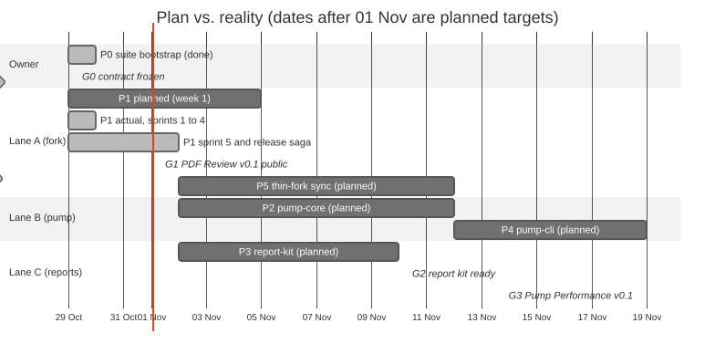
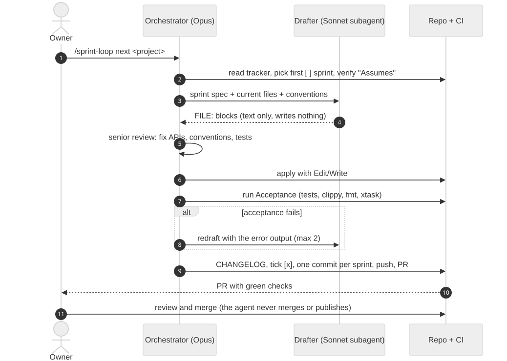
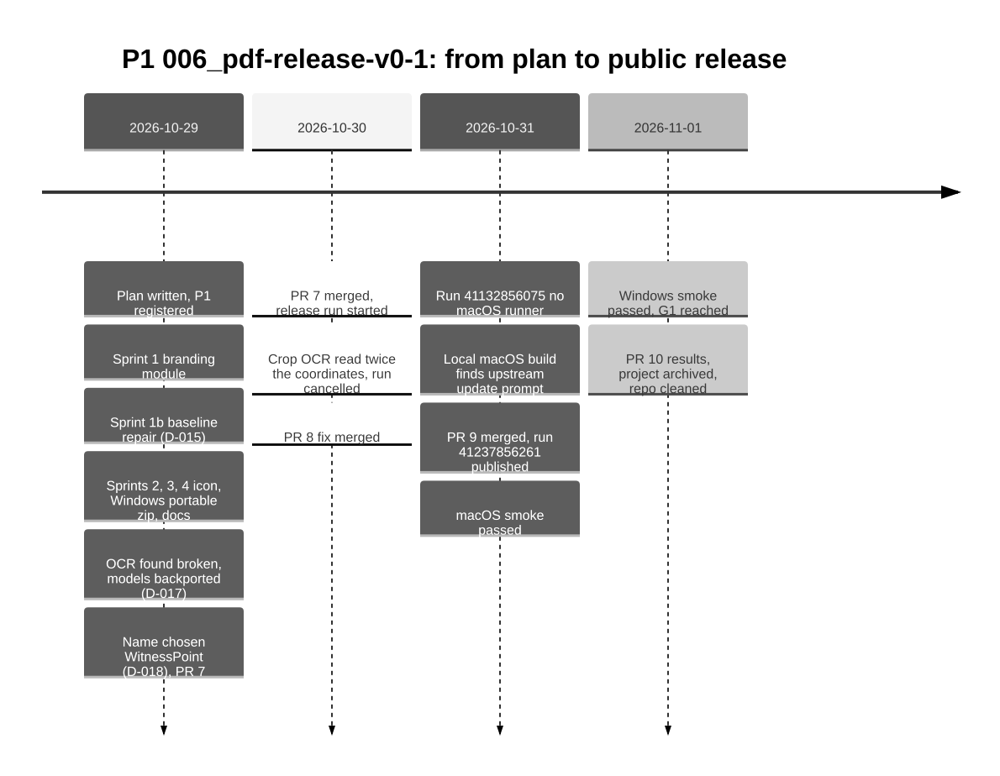
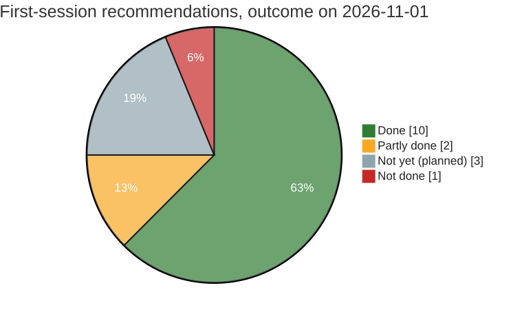

<!-- _class: lead -->
<!-- _paginate: false -->

# Building WitnessPoint PDF Review

From "check my fork" to a public, OCR-verified release in four days, and how to keep it alive

Costa Inspection · WitnessPoint suite · training deck · 2026-11

<!--
Speaker: this deck follows the notes in docs/training/. 01 is the record, 02 the concepts, 03 the handbook, 04 the retrospective. Every number on these slides comes from the journey, the decision log, or a GitHub PR or run.
-->

---

## Agenda

1. The idea: what we started with
2. The plan: repos, lanes, gates
3. The method: sprint-loop
4. Building P1, sprint by sprint
5. The release saga: five problems, five lessons
6. Maintaining the fork
7. When PdfCraft releases a new version
8. Retrospective: was the idea done well?

---

<!-- _class: lead -->

# 1. The idea

---

## Where we started (2026-10-28)

- A fork of **PdfCraft** (Rust PDF editor, MIT OR Apache-2.0), with our own **crop review, OCR on crops, evidence-package export**
- 60 commits, about 10k lines, 5 sprint projects, all tested
- But upstream was **373 commits ahead** in 3 days, and a dry-run merge **conflicted in 16 files**
- About 2,800 of our lines sat **inside upstream's `export.rs`**

> "Analyze my work and solution and advise me like a senior software developer with an eye on the future."

<!--
The code was fine; the problem was where it sat. That's the key diagnosis of the first session.
-->

---

## Five questions, five answers (first session, 10-29)

| Owner asked | Answer |
|---|---|
| How to handle the project? | It's a **downstream product** (D-001): keep the patch to upstream thin |
| Can I publish it and use it at my company for free? | Yes, but **licence ≠ trademark**: remove ArtCraft marks, own name (D-002, D-003) |
| It'll be part of an inspection suite with a pump tool | **3 repos**, a shared evidence format (D-004) |
| API 610: a fast solution from what's ready? | **Ship first, refactor later** (D-005); limits are **data** (D-006) |
| How many projects, in parallel? | P0–P7, **3 lanes**, gates G0–G3 (D-007…D-010) |

---

<!-- _class: lead -->

# 2. The plan

---

## The suite architecture

<!--
Upstream feeds the fork. The fork writes evidence packages that follow the suite's evidence-format contract. The private repo holds client data, templates and the licensed API 610 values, and never goes public.
-->

---

## Lanes and gates: plan vs. reality

G0 contract frozen 10-29 · **G1 PDF Review public 11-01** (target: week 1) · G2, G3 ahead. Bars after 11-01 are planned targets.

---

<!-- _class: lead -->

# 3. The method

---

## sprint-loop: drafter and reviewer

<!--
Self-contained sprints: Goal, Files, Reuse, Tests, Acceptance, Definition of done, Assumes. The Sonnet drafter writes text only; the orchestrator reviews and applies; the owner merges and publishes. The permission system enforced that last part.
-->

---

## Rules that kept it honest

- **One sprint = one commit**; tick it only when its Acceptance commands pass
- **"Assumes" is checked first**; if it fails, write `BLOCKED:` and stop
- The **owner** merges PRs and dispatches releases; the agent never does
- Every session ends with a **journey** entry; every scope change gets a **decision** row
- A reversed decision is **superseded**, never deleted (D-013 → D-014)

---

<!-- _class: lead -->

# 4. Building P1

---

## P1 timeline

---

## Sprint by sprint

| Sprint | Delivered |
|---|---|
| 1 | `branding.rs`; the suite's own mark replaces the ArtCraft logo; "Based on PdfCraft" in About |
| 1b (D-015) | 20 failing tests repaired, 1 real crop-handle bug; **1775 passed, 0 failed** |
| 2 | Own icon, links and publisher; `docs/brand/` deleted; `NOTICE` "modified by Costa Inspection" |
| 3 | Windows **portable zip with the OCR models** |
| 4 | Fork docs in `docs/fork/`; upstream's `AGENTS.md` restored; own README (D-016) |
| 5 | Final name **WitnessPoint** (D-018), the release, smoke tests, G1 |

---

<!-- _class: lead -->

# 5. The release saga

Four release attempts, five problems, and every one caught *before* users saw it

---

## Five problems in a row

Dotted boxes: the check that caught each problem.

---

## Lesson: test the package, not the dev build

- OCR returned junk in **every** build: the models had been swapped for mismatched checkpoints
- The fix (D-017): backport upstream's ONNX models, and add `packaging/ocr-smoke.sh`:
  1. turn text into a picture, so it's a scan with no text layer
  2. OCR it with the **packaged** CLI (no `PDFCRAFT_MODELS`, no source tree)
  3. export a 3-crop package; check each crop's text is **its own line**
- It runs on the Windows zip, the macOS CLI zip and inside the `.app`, and **blocks publishing**

---

## Lesson: a green test can hide a dead feature

- Two export tests passed **because OCR couldn't run**
- When OCR came back, crop OCR read the area at **2× its coordinates** (the tile was scaled twice)
- The evidence image was right and **its text was wrong**: the worst failure for an inspection report
- PR #8: scale once, plus a test that **fails without the fix**; the release run was cancelled before publishing

---

## Lesson: launch the real app

- CI was all green, but GitHub had no macOS runner, so the owner suggested a local build
- On first launch: **"PdfCraft v0.14.0 → 0.15.0, UPDATE AND RESTART"**
- Upstream's updater would have **replaced our app with upstream's branded one**
- PR #9: no check at start; Help ▸ Check for updates opens **our** releases page; 2 guard tests

> No test modelled the app's network behaviour. A person launching it did.

---

## The release pipeline today

---

## Published: `0.14.0-unsigned.20261031`

- Run **41237856261**: universal macOS dmg, macOS CLI zip, Windows x64 portable zip
- macOS smoke (agent, on the downloaded files): checksums match, signature OK, universal, no update prompt, 3 crops → save → reopen → export with DOCX → **each `ocr_text` exactly right**
- Windows smoke (owner, non-admin, portable zip): **passed in full**
- **G1 reached 2026-11-01**; PR #10 recorded the results and archived P1

---

<!-- _class: lead -->

# 6. Maintaining the fork

---

## What lives where

| Piece | Where |
|---|---|
| Names and ids (**source of truth**) | `crates/ui-egui/src/branding.rs`; every copy is marked "keep in sync" |
| Updater (never upstream's feed) | `crates/ui-egui/src/updates.rs` |
| OCR models | `ATTRIBUTION.toml` (SHA-256) + `cargo xtask models` |
| Release | `unsigned-release.yml` (`tag`, `publish`) + `ocr-smoke.sh` |
| Gates | `cargo xtask ci` |
| Runbooks | `docs/fork/techind/update-fork-and-release.md`, `docs/fork/fork-sync-sop.md` |

⚠️ Never create a branch named `release`: it triggers upstream's `release.yml`

---

## Routine release checklist

1. `main` green → tag `<upstream-version>-unsigned.<YYYYMMDD>`
2. Release run with **`publish=false`**; the OCR smoke passes on all 3 packages
3. **Owner** dispatches with `publish=true`
4. Check the 3 assets, then smoke-test the **downloaded** files: OCR, About, no update prompt, crops, save and reopen, export
5. Windows: non-admin account, portable zip
6. CHANGELOG "Released" bullet + journey entry

---

<!-- _class: lead -->

# 7. A new PdfCraft version

---

## Upstream will not wait

- By 11-01, upstream is **742 commits** past our base and has released **v0.16.1**; v0.1 is built on **0.14.0**
- A sync is a real merge, not a fast-forward
- First ask: **do I need the whole release, or one fix?** One fix means a narrow backport plus a decision (like D-017)
- Today: merge on a `sync/YYYYMMDD` branch, through a PR. After P5: rebase the small hooks

---

## The upgrade flow

Exact commands: the fork's `docs/fork/techind/update-fork-and-release.md`. Never auto-resolve a conflict; never re-run an old release run.

---

## The must-keep checklist (after every merge)

| # | Must stay true |
|---|---|
| 1 | No ArtCraft marks (logo, `docs/brand/`, community links) |
| 2 | Names and ids from `branding.rs` in every copy |
| 3 | The MSI's own `UpgradeCode` (Package **and** `<Upgrade Id>`) |
| 4 | **The updater never asks upstream** (2 guard tests + launch the app) |
| 5 | ONNX OCR models, SHA-256, models in every package |
| 6 | Crop OCR reads the selected area (engine test) |
| 7 | The crop-review hooks are still wired in |
| 8 | Parity evidence names tests that exist |
| 9 | Fork README, `NOTICE`, `docs/fork/` |
| 10 | Upstream's `AGENTS.md`, `CLAUDE.md`, `ROADMAP.md` byte-identical |

---

## The real fix: thin fork (P5)

- A backup tag, then a branch from `upstream/main`
- Re-add the crop review as **new files** with small hooks
- Move the ~2,800 lines out of `export.rs` into a fork-owned crate
- A **nightly build on the latest upstream**, plus a weekly sync routine
- Done when the fork touches about 10 upstream files or fewer

⚠️ Upstream CI rejects git dependencies outside `github.com/storytold/`; P5 needs a decision on how the fork gets `evidence-format`

---

<!-- _class: lead -->

# 8. Retrospective

---

## Was the idea done well?

16 first-session recommendations: 10 done · 2 partly (name, API 610 values) · 3 planned (golden tests, thin fork, pump tool) · 1 not done (upstream issue)

---

## Verdict

**Yes, and the core bet was right.** Ship first gave a working, honestly branded, OCR-verified release in four days, and caught three bugs that matter most for inspection evidence.

**Weak spots**
- Release work was underestimated: 4 attempts, 3 unplanned fixes
- Checks were scoped too narrowly: the shipped `NOTICE` still says **`<Suite> PDF Review`**
- The free step was skipped: the upstream extension-point issue
- The *suite* value (pump tool, G3) is still ahead

---

## Next steps

1. **v0.1.1 hygiene patch:** replace `<Suite>` in `NOTICE`, `ATTRIBUTION.*` and the icon docs; widen the grep
2. **Open the upstream issue** (area/crop export extension point)
3. **P5 thin fork:** decide the git-dependency question first
4. **Owner inputs U2 + U3** (API 610 values, golden jobs): the critical path to G3
5. **"Launch the shipped binary"** in every release sprint

---

<!-- _class: lead -->

# Questions?

Notes: `docs/training/` · Plan: `docs/plan/official-plan.md` · Journey: `docs/journey.md` · Decisions: `docs/decisions.md`
